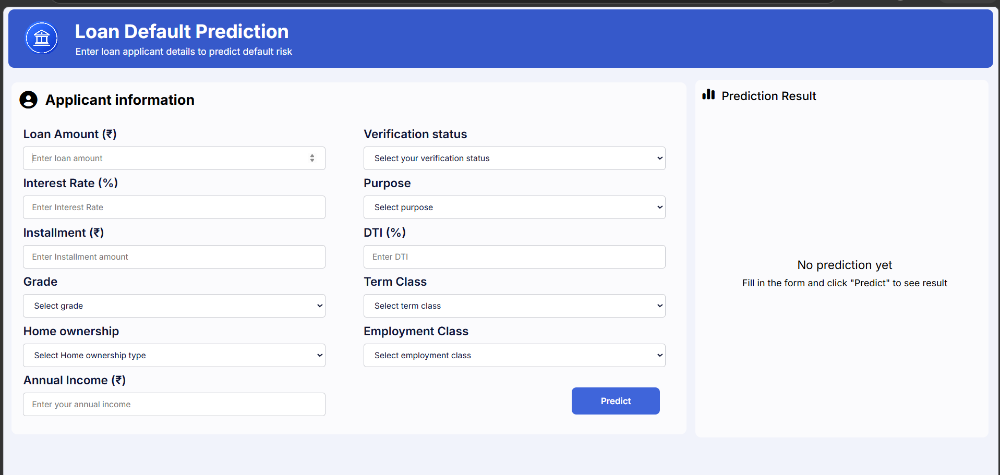
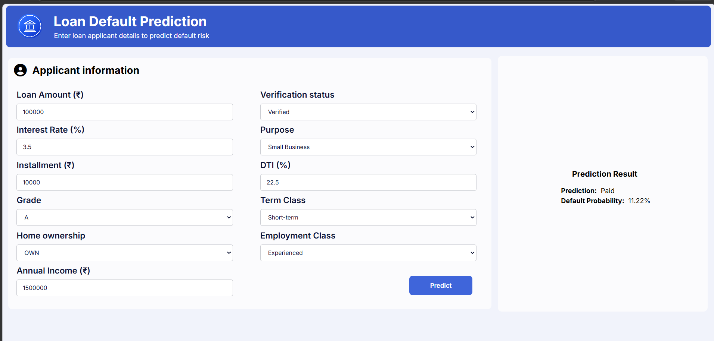

# 💳 Loan Default Prediction System

A machine learning-based web application that predicts whether a loan applicant is likely to **Pay** or **Not Pay** based on their financial and loan-related information.

The project combines a **machine learning classification model**, **FastAPI backend**, and a **HTML/CSS/JavaScript frontend** to provide predictions through a simple web interface.


## 📌 Project Overview

Loan default prediction is a classification problem where the objective is to estimate whether a borrower is likely to repay a loan.

This project takes applicant information such as:

- Loan amount
- Interest rate
- Installment
- Loan grade
- Home ownership
- Annual income
- Verification status
- Loan purpose
- Debt-to-income ratio
- Loan term
- Employment experience

and uses a trained machine learning model to predict:

> **Paid** or **Not Paid**

The model also provides an estimated **default probability**, which is used with a decision threshold to determine the final prediction.

---

## 🚀 Features

- 📊 Exploratory Data Analysis (EDA)
- 🧹 Data preprocessing and cleaning
- 🤖 Machine learning classification
- 📈 Probability-based prediction
- 🎯 Configurable classification threshold
- ⚡ FastAPI
- 🌐 HTML/CSS/JavaScript frontend
- 🔄 Frontend-backend integration
- 📋 Input validation using Pydantic
- 📦 Serialized machine learning pipeline
- 📱 Simple and user-friendly interface

---

## 🛠️ Tech Stack

### Machine Learning

- Python
- Pandas
- NumPy
- Scikit-learn
- Matplotlib
- Seaborn

### Backend

- FastAPI
- Uvicorn
- Pydantic

### Frontend

- HTML5
- CSS3
- JavaScript
- Font Awesome

### Model

- Logistic Regression
- Scikit-learn Pipeline
- One-Hot Encoding
- Ordinal Encoding
- Standard Scaling
- Data Imputation
- Power Transformation

---

## 📂 Project Structure

```text
Loan Default Prediction/
│
├── backend/
│   └── app.py
│
├── frontend/
│   ├── index.html
│   ├── style.css
│   ├── script.js
│   └── loan_logo.png
│
├── ml/
│   ├── preprocessing.ipynb
│   ├── loan default prediction.ipynb
│   ├── model.pkl
│   └── accepted_2007_to_2018Q4.csv.gz   # not included, see Dataset section below
│
├── .gitignore
├── requirements.txt
└── README.md
```

---

## 📊 Dataset

This project uses the **Lending Club Loan Data** (`accepted_2007_to_2018Q4.csv.gz`), which is **not included** in this repository due to its large size (~383MB).

To run the notebooks, download the dataset from [Kaggle - Lending Club Loan Data](https://www.kaggle.com/datasets/wordsforthewise/lending-club) and place it inside the `ml/` folder before running `preprocessing.ipynb`.

---

## Requirements

- Python 3.12+
- FastAPI
- Uvicorn
- Pandas
- NumPy
- Scikit-learn
- Pydantic

Install all dependencies using:

```bash
pip install -r requirements.txt
```

---

## ⚙️ Setup & Usage

1. Clone the repository:
   ```bash
   git clone https://github.com/mistrypareet26-dev/Loan-Default-Prediction.git
   cd Loan-Default-Prediction
   ```

2. Create a virtual environment and activate it:
   ```bash
   python -m venv .venv
   .venv\Scripts\Activate.ps1
   ```

3. Install dependencies:
   ```bash
   pip install -r requirements.txt
   ```

4. Run the backend server:
   ```bash
   cd backend
   uvicorn app:app --reload
   ```

5. Open `frontend/index.html` in your browser to use the interface.

---

## 🤖 Model
The trained model (`ml/model.pkl`) predicts loan default risk based on applicant and loan features. See `ml/preprocessing.ipynb` and `ml/loan default prediction.ipynb` for the full data preprocessing and model training pipeline.

## 🖼️ Screenshots

### Home Page


### Prediction Result

